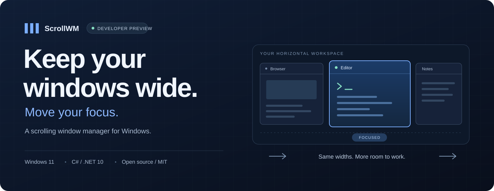
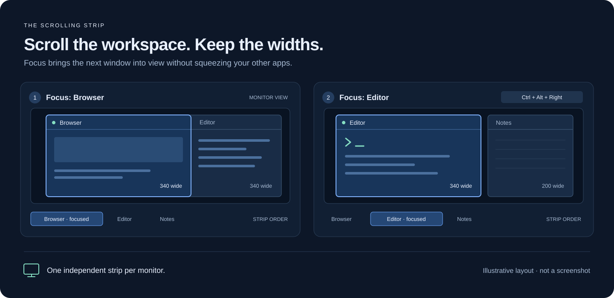
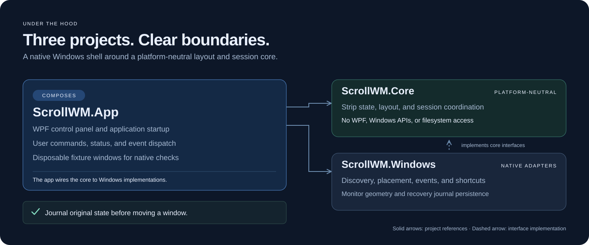

<p align="center">
  
</p>

<p align="center">
  <strong>A horizontal workspace for your real application windows.</strong><br />
  Keep useful widths, navigate with the keyboard, and give each monitor its own strip.
</p>

<p align="center">
  <a href="#try-the-preview">Try the preview</a> ·
  <a href="docs/strip-preview.md">User guide</a> ·
  <a href="docs/architecture.md">Architecture</a> ·
  <a href="CONTRIBUTING.md">Contribute</a> ·
  <a href="LICENSE">MIT license</a>
</p>

#  ScrollWM

ScrollWM is an experimental, open source scrolling window manager for **Windows 11 x64**, built with C# and WPF on .NET 10. Opening another app extends a horizontal strip instead of shrinking the windows you already use. Move your focus along the strip and the next window comes into view.

**Status: developer preview.** Multi-monitor strips are implemented; the everyday MVP is still in development. ScrollWM is a working name.

**[Download v0.0.1 for Windows x64](https://github.com/rafaelsilvabr/scrollwm/releases/tag/v0.0.1)** — a self-contained `.exe` and a portable ZIP with the license and usage notes. No .NET installation is needed to run the packaged app. The executable is unsigned.

## A workspace that moves with you



*Concept illustration, not a screenshot. Edge windows overlap beneath fully visible windows; fully hidden columns park beyond the connected screens.*

- **Keep your widths.** Choose a third, half, two thirds, or full width. Adding a window preserves existing widths; application minimum sizes take precedence.
- **Navigate and reorder.** Focus the previous or next column, move a column, or cycle its width with global shortcuts.
- **Use multiple monitors.** Each monitor keeps its own order, focus, widths, and scroll offset. Transfer the focused window to the next monitor.
- **Choose what joins.** Start explicitly with selected windows, add open windows, or opt into automatic enrollment of newly opened eligible windows.
- **Restore your desktop.** Original placements and window shapes are journaled before movement. Pause restores them; recovery retains entries that could not be restored.
- **Keep data local.** No account, network service, or telemetry. Recovery data stays on your machine.

See the [illustrated control-panel preview](docs/assets/scrollwm-ui.svg) and the [full usage guide](docs/strip-preview.md) for the UI and window lifecycle behavior.

## Try the preview

For the packaged app, download `ScrollWM-0.0.1-win-x64.zip` from the [release page](https://github.com/rafaelsilvabr/scrollwm/releases/tag/v0.0.1), extract it, and run `ScrollWM.exe`. The standalone `ScrollWM-0.0.1-win-x64.exe` runs the same app. See the [release notes](docs/releases/v0.0.1.md) for checksums, first-run instructions, and limitations.

### Build from source

You need **Windows 11 x64** and the **[.NET 10 SDK](https://dotnet.microsoft.com/download/dotnet/10.0)** to build. `global.json` accepts stable .NET 10 SDK feature bands starting at 10.0.100. A runtime alone cannot build the app.

Download or clone this repository, open PowerShell in its root, and run:

```powershell
dotnet --list-sdks
dotnet restore ScrollWM.slnx
dotnet build ScrollWM.slnx --configuration Release --no-restore
.\run.ps1
```

The launcher runs an existing Release build directly. Use `.\run.ps1 -Build` after changing source; close running preview and fixture processes before rebuilding. If `.tools/dotnet/dotnet.exe` exists, the launcher uses that local SDK for builds. For the commands above, replace `dotnet` with `.\.tools\dotnet\dotnet.exe` to use it explicitly.

For a first run with disposable windows, open a second PowerShell terminal in the repository root:

```powershell
.\run.ps1 -FixtureCount 5
```

In the manager:

1. On **Scrolling strip**, review the available windows. All eligible windows are selected by default; Ctrl+click to select only the disposable test windows if desired.
2. Click **Start strip**. Opening the manager does not start a session automatically.
3. Navigate with **Ctrl+Alt+Left / Right**, then try **Ctrl+Alt+W** to cycle the focused window's width.
4. Click **Pause & restore** to return windows to their captured placements.

If activation is blocked, read the banner above the controls. Minimized and maximized windows must first be restored to normal windows. The **Position probes** tab is a separate diagnostic workbench with a single-monitor restriction.

### Keyboard controls

| Action | Shortcut |
| --- | --- |
| Focus previous / next window | `Ctrl+Alt+Left` / `Right` |
| Reorder focused window | `Ctrl+Alt+Shift+Left` / `Right` |
| Cycle width: third → half → two thirds → full | `Ctrl+Alt+W` |
| Transfer focused window to the next monitor | `Ctrl+Alt+M` |
| Pause / resume | `Ctrl+Alt+P` |
| Emergency restore and release strip shortcuts | `Ctrl+Alt+Shift+Esc` |

Navigation stops at either end. A conflicting global shortcut prevents strip startup and is reported in the UI.

### Recovery and current limits

The default data directory is `%LOCALAPPDATA%\ScrollWM`. To use a separate directory:

```powershell
.\run.ps1 -DataDirectory .\local-data\preview
```

Pause and normal exit attempt restoration. After a crash, reopen ScrollWM with the same data directory and use the recovery controls. Keep recovery files until all pending entries are resolved. Resume captures fresh original placements; strip order and preferences do not persist across app restarts.

Mixed DPI, display disconnect/reconnect, native drag/resize gestures, and broader application compatibility still need real-desktop verification. Tray controls, persistent settings, automatic startup, touch/trackpad navigation, and animations are planned. See the [preview limits](docs/strip-preview.md#preview-limits), [multi-monitor matrix](docs/multi-monitor-plan.md), and [MVP plan](docs/mvp-plan.md).

## How it is built



The WPF app composes a platform-neutral core and Windows adapters. The core computes layouts and serializes session commands; native adapters discover windows, apply placements, register shortcuts, and persist recovery data. Original state is saved before the first managed move. See the [architecture](docs/architecture.md) and [design decisions](docs/decisions/0001-windows-native.md).

```text
src/ScrollWM.App/             WPF control panel and disposable test windows
src/ScrollWM.Core/            Strip layout, session state, recovery coordination
src/ScrollWM.Windows/         Native windows, monitors, hooks, shortcuts, journal
tests/                       Core rules and recovery persistence tests
tools/ScrollWM.Spike/         Opt-in native verification and recovery tools
docs/                        Guides, architecture decisions, verification records
.github/                     CI, dependency updates, issue and PR templates
```

## Development and verification

```powershell
dotnet restore ScrollWM.slnx
dotnet build ScrollWM.slnx --configuration Release --no-restore
dotnet test ScrollWM.slnx --configuration Release --no-build --no-restore
```

CI builds and runs automated tests on Windows. Native desktop experiments remain opt-in and separate from CI.

The recorded two-monitor checks at 100% scaling passed 15 native fixture checks and 36 Chrome / VS Code / Xournal++ placement checks, including restoration. These results describe the tested configuration; the remaining compatibility matrix is open. See the [verification records](docs/multi-monitor-plan.md#edge-visibility-correction--2026-11-09), [UI checks](docs/ui-verification.md), and [manual test plan](docs/manual-test-plan.md) for scope and limitations.

## Contributing

Bug reports, compatibility results, documentation improvements, and focused pull requests are welcome. Read [CONTRIBUTING.md](CONTRIBUTING.md) for setup, design boundaries, and review expectations. Use disposable or non-sensitive windows in reproductions and remove private information from reports.

Report vulnerabilities using [SECURITY.md](SECURITY.md). Changes are tracked in [CHANGELOG.md](CHANGELOG.md). Maintainers preparing the GitHub repository can follow the [publication guide](docs/publishing.md).

## Support the project

If ScrollWM helps your workflow, you can support its development: [Buy me a coffee](https://buymeacoffee.com/rafaelsilvabr).

## License

[MIT](LICENSE) © 2026 ScrollWM contributors. The SVG artwork in `docs/assets/` is included under the same license.
